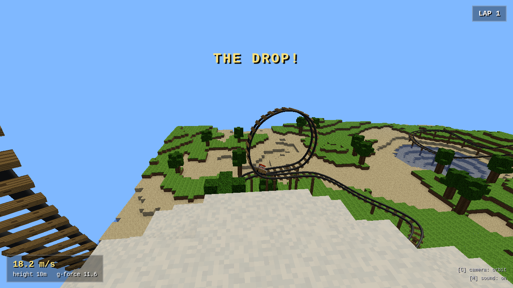
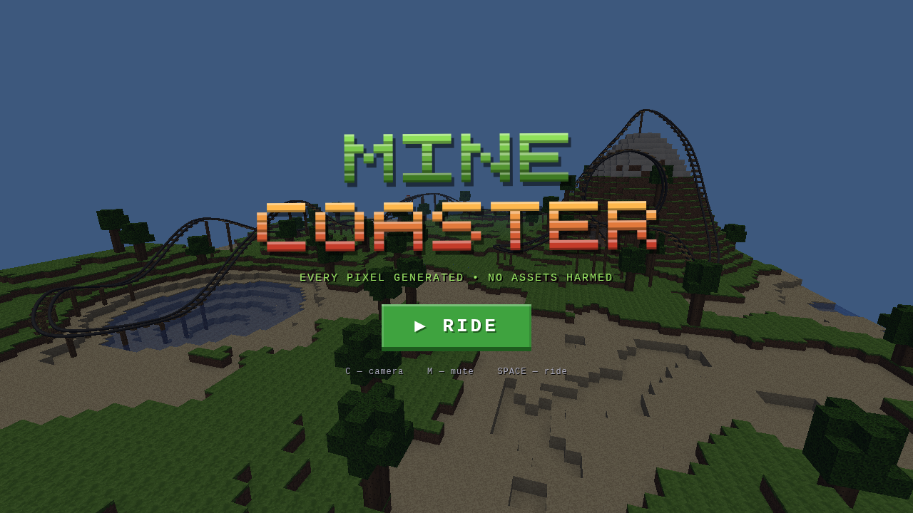
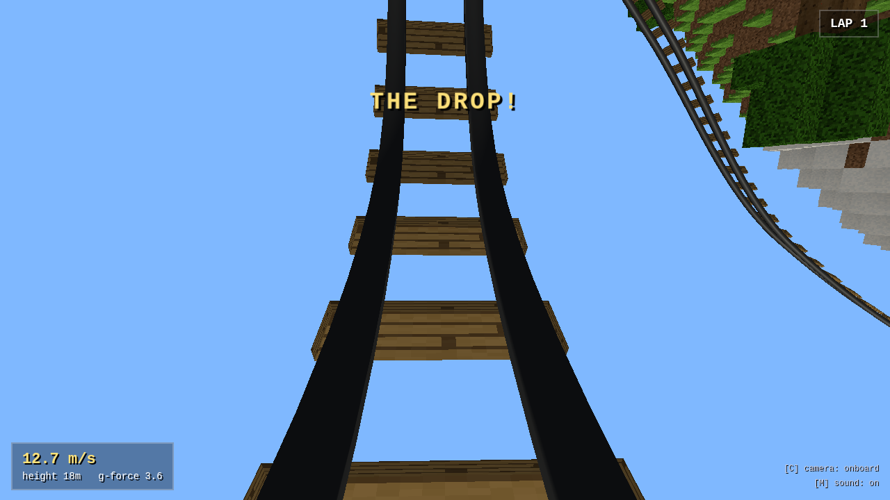
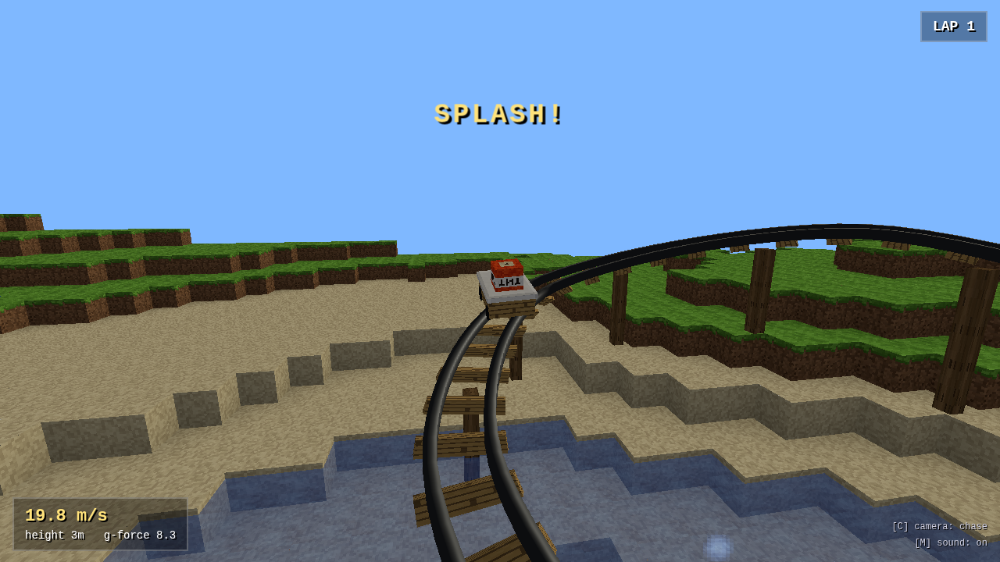

# 🎢 MineCoaster

A Minecraft-style voxel roller coaster that runs entirely in your browser —
chain lift, monster drop, vertical loop, glowing lava tunnel, and a lake splash,
all in one ride.

**Every single sprite, texture, sound, and the logo are generated by code at
runtime.** The game loads zero image, audio, or model assets: block textures
are 16×16 pixel art painted into RGBA buffers, the world is carved out of
seeded noise, and the soundtrack of clanks, whooshes, and firework pops is
synthesized with WebAudio. (The only images in this repo are the screenshots
below.)



| Title screen                   | The drop (onboard)          | Lake skim                       |
| ------------------------------ | --------------------------- | ------------------------------- |
|   |  |  |

## Ride it

```bash
npm install
npm run dev          # then open the printed URL and press RIDE
```

| Key     | Action                                  |
| ------- | --------------------------------------- |
| `SPACE` | start the ride                          |
| `C`     | cycle camera (onboard → chase → orbit)  |
| `M`     | mute / unmute                           |

The ride: launch out of the station, clank up the chain lift to the snowy
summit, drop down the mountain face, swing through a vertical loop, dive into a
carved tunnel past a lava pocket, skim across the lake (splash included), hit
the brake run, and roll home — fireworks on every lap. A full day/night cycle
plays out as you ride, square sun included.

## How it works

```
src/
├── core/      seeded RNG, value noise, vec3 math          (pure, no deps)
├── art/       16×16 pixel-art texture generator + atlas   (pure RGBA buffers)
├── world/     voxel terrain generator + face-culled       (pure typed arrays)
│              mesher with baked ambient occlusion
├── coaster/   Catmull-Rom track with parallel-transport   (pure math)
│              frames, gravity-coaster physics, ride layout
└── game/      the only layer that touches Three.js / DOM:
               scene, cameras, HUD, particles, WebAudio synth
```

The split is strict: everything under `core/`, `art/`, `world/`, and `coaster/`
is plain TypeScript with no DOM or Three.js imports, fully deterministic from
seeds, and unit-tested in Node. The `game/` layer wraps those buffers into
Three.js textures and geometry.

Physics is a real gravity coaster: the train trades height for speed with
rolling friction and air drag; chain-lift, launch, and brake zones override
acceleration along arc-length ranges of the spline. The simulation runs on a
fixed 120 Hz timestep, which makes it deterministic — the integration tests
exploit that with a `warp()` hook to fast-forward whole laps.

## Tests

```bash
npm test                  # unit tests (Vitest): math, art, worldgen, physics
npm run build             # typecheck + production build
npm run browsers          # one-time: download Playwright's Chromium (kept inside node_modules)
npm run test:integration  # Playwright: boots the real build in Chromium
npm run test:all          # all of the above (after the one-time browsers step)
```

Unit tests cover the pure core (spline arc-length and frame orthonormality
through the loop, energy conservation, texture determinism and atlas packing,
terrain invariants, mesher face counts and AO). Playwright integration tests
drive the production build in headless Chromium: boot without console errors,
verify the canvas actually paints a moving scene, ride a full lap via the
deterministic warp hook, and exercise the camera/mute controls.

CI runs the whole suite on pushes to `main` and on every pull request; when
the suite is green on `main`, the same workflow deploys the build to GitHub
Pages.

## Development

```bash
npm run dev          # Vite dev server with HMR
npm run test:watch   # Vitest in watch mode
npm run preview      # serve the production build locally
```

Want a different world? Change `WORLD_SEED` in `src/coaster/layout.ts` — the
terrain, textures, and tunnel carving all re-derive from it. The track layout
self-adjusts: control points anchor to the generated terrain and the builder
automatically lifts any section that would clip a hill.

## License

MIT
